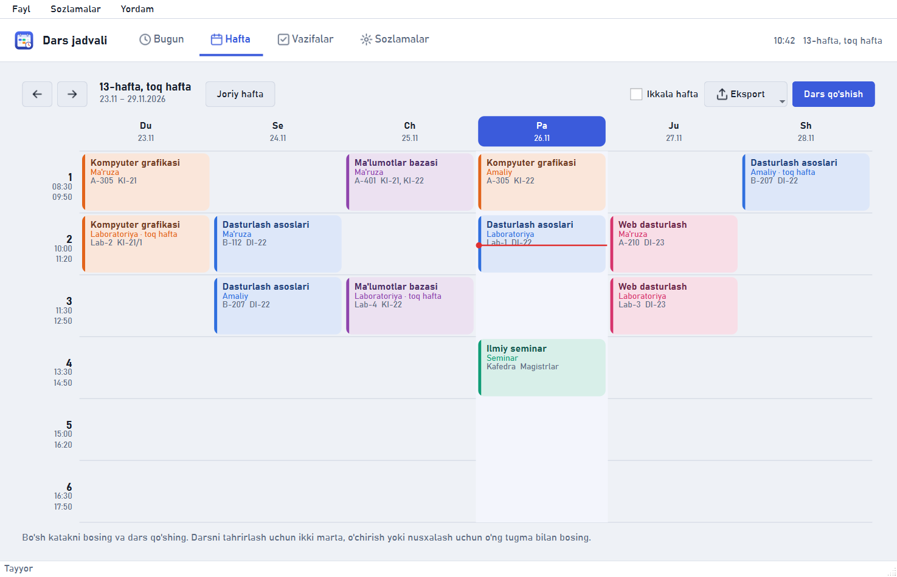
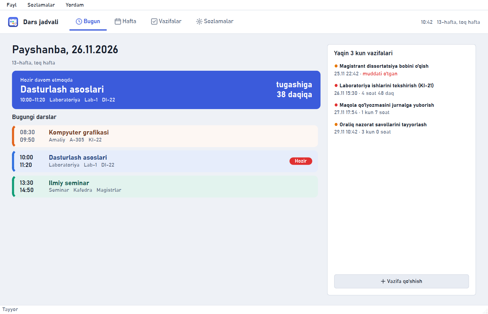
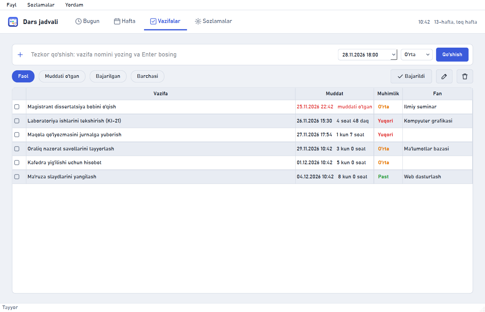
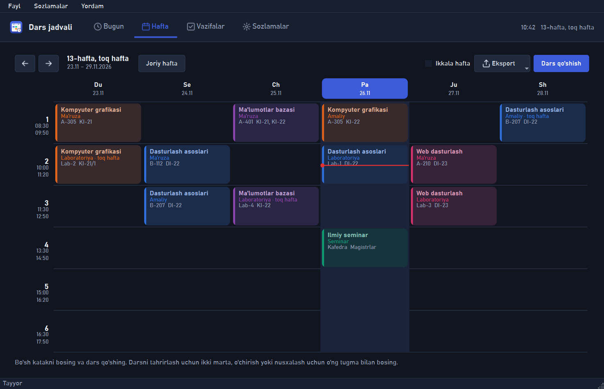
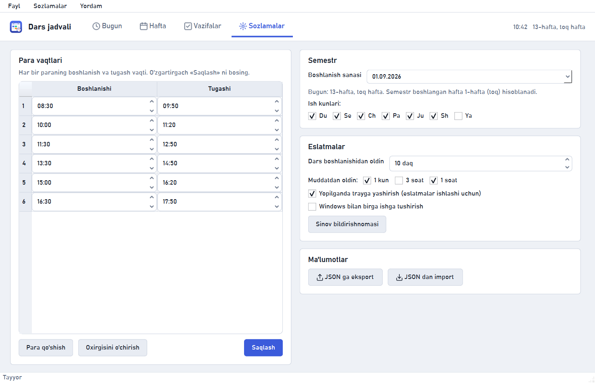

<h1 align="center">Dars jadvali va deadline eslatuvchisi</h1>

<b>Timetable & Deadline Reminder</b> · Расписание занятий и напоминания о сроках

   
  
  
  
  

O'qituvchi uchun haftalik dars jadvali: para vaqtlari, toq/juft haftalar, xona va guruhlar, rangli hafta to'ri, bugungi darslar, vazifalar va muddatlar. Dars boshlanishi va muddatlar oldidan Windows bildirishnomasi chiqaradi.

## Imkoniyatlar

- Para vaqtlari sozlanadi (8:30–9:50 ...), ish kunlari tanlanadi
- Toq/juft hafta: semestr boshidan hafta raqami avtomatik
- Rangli hafta to'ri: fan, turi (ma'ruza, amaliy, laboratoriya, seminar), xona, guruh
- Bugun sahifasi: keyingi darsgacha qolgan vaqt va bugungi vazifalar
- Vazifalar: muhimlik, muddat, tezkor qo'shish (Ctrl+N)
- Darsdan N daqiqa va muddatdan 1 kun / 1 soat oldin bildirishnoma (tray)
- Jadvalni PDF va PNG ga eksport, chop etish; JSON import/eksport
- O'zbek, rus, ingliz tillari; yorug' va qorong'i mavzu; offline

## O'rnatish

1. [**DarsJadvali.exe**](https://github.com/eduhakimov/dars-jadvali/releases/latest/download/DarsJadvali.exe) faylini yuklab oling.
2. Faylni ishga tushiring, o'rnatish shart emas.
3. Windows SmartScreen ogohlantirsa: **Batafsil → Baribir ishga tushirish**.

**Tizim talablari:** Windows 10 (1809+) / Windows 11, x64

## Hujjatlar

- [Ilmiy maqola](docs/materiallar/ILMIY-MAQOLA.md)
- [Foydalanish qo‘llanmasi](docs/materiallar/FOYDALANISH-QOLLANMASI.md)
- [Uslubiy ko‘rsatma](docs/materiallar/USLUBIY-KORSATMA.md)

Word formatida: [foydalanish qo‘llanmasi](docs/materiallar/Dars%20jadvali%20va%20deadline%20eslatuvchisi%20-%20foydalanish%20qo‘llanmasi.docx) · [ilmiy maqola](docs/materiallar/Dars%20jadvali%20va%20deadline%20eslatuvchisi%20-%20ilmiy%20maqola.docx) · [uslubiy ko‘rsatma](docs/materiallar/Dars%20jadvali%20va%20deadline%20eslatuvchisi%20-%20uslubiy%20ko‘rsatma.docx)

---

## Русский

Недельное расписание для преподавателя: время пар, чётные/нечётные недели, аудитории и группы, цветная сетка недели, занятия на сегодня, задачи и сроки. Перед началом пары и перед сроками показывает уведомления Windows.

- Настраиваемое время пар (8:30–9:50 ...) и рабочие дни
- Чётные/нечётные недели: номер недели от начала семестра
- Цветная сетка недели: предмет, тип (лекция, практика, лабораторная, семинар), аудитория, группа
- Страница «Сегодня»: время до следующей пары и задачи на сегодня
- Задачи: приоритет, срок, быстрое добавление (Ctrl+N)
- Уведомления за N минут до пары и за 1 день / 1 час до срока (трей)
- Экспорт расписания в PDF и PNG, печать; импорт/экспорт JSON
- Узбекский, русский, английский; светлая и тёмная тема; офлайн

## English

A weekly timetable for lecturers: class periods, odd/even weeks, rooms and groups, a colour week grid, today's classes, tasks and deadlines. Shows Windows notifications before classes start and before deadlines.

- Configurable class periods (8:30–9:50 ...) and working days
- Odd/even weeks: week number counted from the semester start
- Colour week grid: subject, type (lecture, practical, lab, seminar), room, group
- Today page: time to the next class and tasks due today
- Tasks with priority and due time, quick add (Ctrl+N)
- Notifications N minutes before a class and 1 day / 1 hour before deadlines (tray)
- Export timetable to PDF and PNG, print; JSON import/export
- Uzbek, Russian, English; light and dark themes; offline

---

## Muallif / Author

**Bahtiyorjon Hakimov** (Hakimov Bahtiyorjon Muzaffar o'g'li), [github.com/eduhakimov](https://github.com/eduhakimov)

© 2026 Bahtiyorjon Hakimov. Barcha huquqlar himoyalangan. / Все права защищены. / All rights reserved.
Batafsil: [LICENSE](LICENSE) · Uchinchi tomon komponentlari: [THIRD_PARTY_NOTICES.md](THIRD_PARTY_NOTICES.md)
