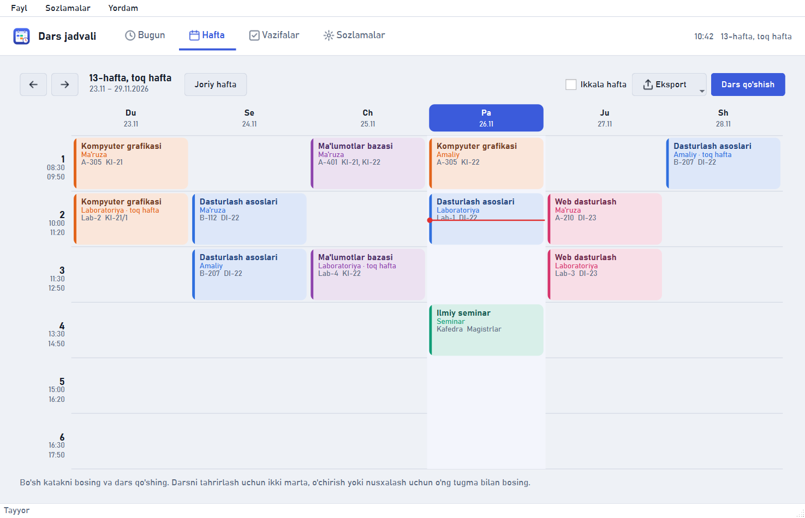
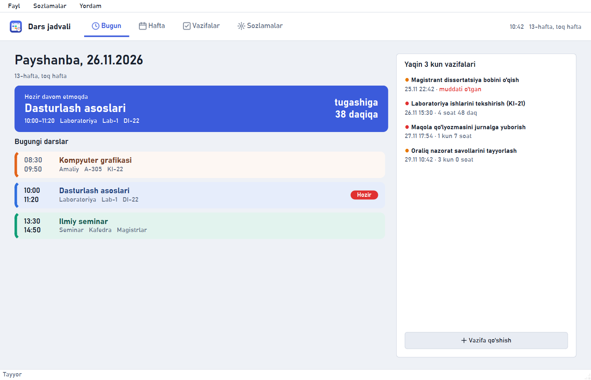
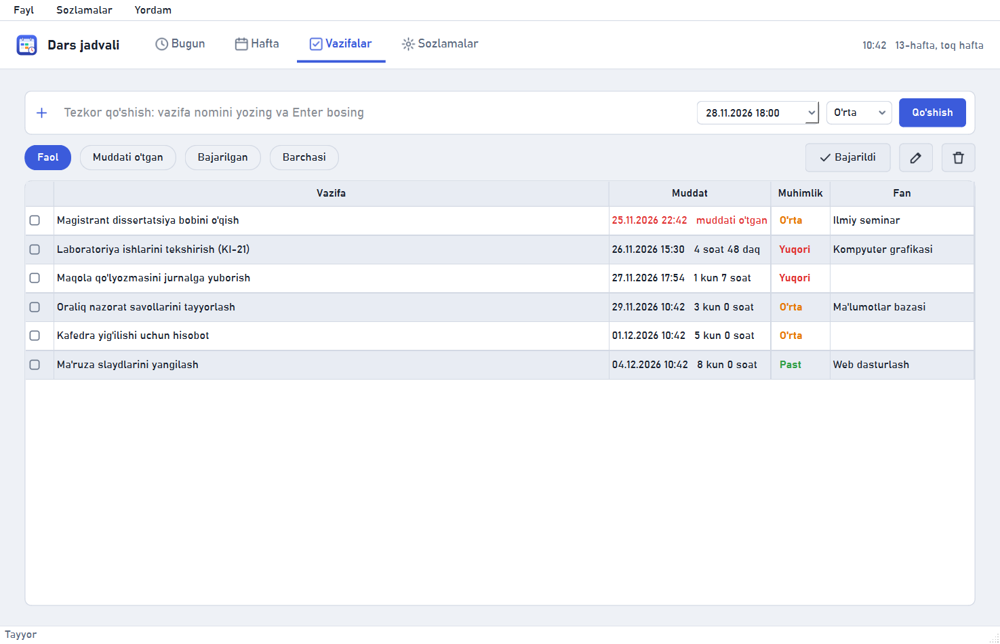
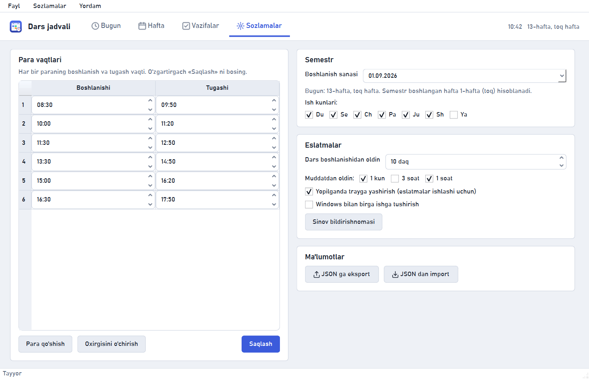
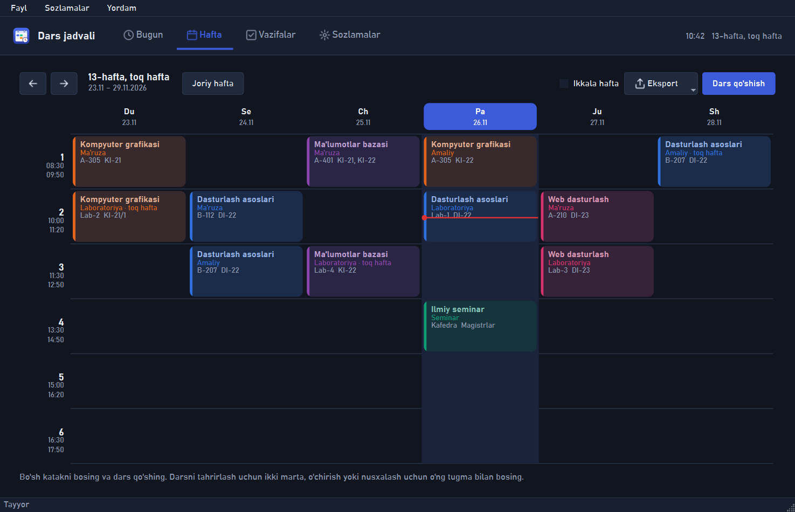

# Dars jadvali va deadline eslatuvchisi: Foydalanish qo‘llanmasi

Muallif: Hakimov Bahtiyorjon. Versiya: 1.0.2.

## 1. Umumiy ma’lumot

“Dars jadvali va deadline eslatuvchisi” – o‘qituvchi uchun haftalik dars jadvali va vazifalar muddatlarini yurituvchi dastur. Unda para vaqtlari, toq va juft haftalar, xona va guruhlar, rangli hafta to‘ri, bugungi darslar, vazifalar va muddatlar bir joyda turadi. Dars boshlanishi va vazifa muddati oldidan dastur Windows bildirishnomasini chiqaradi.

Dastur joriy hafta raqamini va uning toq yoki juft ekanini semestr boshlanish sanasidan o‘zi hisoblaydi. Har haftada, faqat toq yoki faqat juft haftalarda o‘tadigan darslar to‘g‘ri haftada ko‘rsatiladi.

Dastur oliy ta’lim muassasalari, kollej va texnikumlar o‘qituvchilari uchun mo‘ljallangan. Undan talabalar, magistrantlar va doktorantlar ham o‘z dars jadvali va topshiriqlari muddatlarini kuzatish uchun foydalanishi mumkin.

Dastur to‘rt sahifadan iborat: “Bugun” – shu kungi darslar va yaqin vazifalar; “Hafta” – haftalik jadval; “Vazifalar” – muddatli ishlar ro‘yxati; “Sozlamalar” – para vaqtlari, semestr, eslatmalar va ma’lumotlar. Oxirgi ochilgan sahifa keyingi safar eslab qolinadi.

## 2. Tizim talablari

- Operatsion tizim: Windows 10 (1809 yoki undan keyingi versiya) yoki Windows 11, 64 bitli (x64).
- Internet aloqasi talab qilinmaydi: dastur to‘liq oflayn ishlaydi.
- O‘rnatish shart emas: dastur bitta .exe fayldan iborat.
- Bildirishnomalar ko‘rinishi uchun Windows bildirishnomalari yoqilgan bo‘lishi kerak.
- Chop etish uchun kompyuterga printer ulangan bo‘lishi kerak; PDF va PNG eksport printersiz ishlaydi.

## 3. O‘rnatish va ishga tushirish

1. Dasturning GitHub sahifasidagi Releases bo‘limidan (https://github.com/eduhakimov/dars-jadvali/releases) .exe faylni yuklab oling.
2. Faylni doimiy turadigan papkaga joylashtiring. Agar keyinchalik “Windows bilan birga ishga tushirish” ni yoqsangiz, faylni boshqa joyga ko‘chirmang.
3. Faylni ikki marta bosib ishga tushiring.
4. Birinchi ishga tushirishda Windows SmartScreen ogohlantirishi chiqishi mumkin. Bunday holda “Batafsil”, so‘ng “Baribir ishga tushirish” tugmasini bosing.
**Birinchi sozlash**

1. “Sozlamalar” sahifasida para vaqtlarini tekshiring (standart: 08:30–09:50, 10:00–11:20, 11:30–12:50, 13:30–14:50, 15:00–16:20, 16:30–17:50) va “Saqlash” ni bosing.
2. “Semestr” bo‘limida “Boshlanish sanasi” ni kiriting. Shu sana tushgan hafta 1-hafta (toq) hisoblanadi.
3. “Ish kunlari” dan dars o‘tiladigan kunlarni belgilang.
Birinchi sozlashdan so‘ng “Hafta” sahifasiga o‘tib, darslarni kiritishni boshlang. Yangi versiyaga o‘tishda eski .exe faylni yangisi bilan almashtirish kifoya: ma’lumotlar foydalanuvchi profilida saqlangani uchun yo‘qolmaydi.

## 4. Dastur oynasi bilan tanishish

Oyna yuqorisida menyu satri (“Fayl”, “Sozlamalar”, “Yordam”), uning ostida esa dastur nomi va to‘rtta sahifa yorlig‘i joylashgan: “Bugun”, “Hafta”, “Vazifalar”, “Sozlamalar”. O‘ng yuqori burchakda joriy vaqt va hafta, masalan, “13-hafta, toq hafta” ko‘rsatiladi.

**Hafta** (1-rasm). Rangli hafta to‘ri: ustunlar – kunlar, qatorlar – paralar. Yuqorida strelkalar, hafta raqami va sanalari, “Joriy hafta” tugmasi, “Ikkala hafta” bayrog‘i, “Eksport” menyusi va “Dars qo‘shish” tugmasi bor. Pastda qisqa yo‘riqnoma yozilgan.

**Bugun** (2-rasm). Sana, “Hozir davom etmoqda” yoki “Keyingi dars” bloki, “Bugungi darslar” ro‘yxati va o‘ngda “Yaqin 3 kun vazifalari” paneli hamda “Vazifa qo‘shish” tugmasi.

**Vazifalar** (3-rasm). Tezkor qo‘shish maydoni, muddat va muhimlik tanlovi, “Qo‘shish” tugmasi, filtrlar, “Bajarildi”, tahrirlash va o‘chirish tugmalari hamda “Vazifa”, “Muddat”, “Muhimlik”, “Fan” ustunli jadval.

**Sozlamalar** (5-rasm). “Para vaqtlari”, “Semestr”, “Eslatmalar” va “Ma’lumotlar” bo‘limlari.

*1-rasm. “Hafta” sahifasi (yorug‘ mavzu): 13-hafta (toq hafta) uchun rangli dars to‘ri, olti para va ish kunlari bo‘yicha fan, turi, xona va guruh ko‘rsatilgan; joriy kun ajratilgan, joriy vaqt qizil chiziq bilan belgilangan*

*2-rasm. “Bugun” sahifasi: “Hozir davom etmoqda” bloki va tugashiga qolgan vaqt, “Bugungi darslar” ro‘yxati, o‘ngda “Yaqin 3 kun vazifalari”*

*3-rasm. “Vazifalar” sahifasi: tezkor qo‘shish maydoni, “Faol”, “Muddati o‘tgan”, “Bajarilgan”, “Barchasi” filtrlari, vazifalar jadvali muddat, qolgan vaqt, muhimlik va fan bilan*

*4-rasm. “Sozlamalar” sahifasi: “Para vaqtlari” jadvali, “Semestr” boshlanish sanasi va ish kunlari, “Eslatmalar” va “Ma’lumotlar” bo‘limlari*

## 5. Asosiy amallar

**Dars qo‘shish**

1. “Hafta” sahifasida kerakli kun va para kesishgan bo‘sh katakni bosing yoki “Dars qo‘shish” tugmasini bosing (Ctrl+L).
2. “Fan” maydoniga fan nomini yozing, masalan, “Kompyuter grafikasi”.
3. “Turi” dan “Ma’ruza”, “Amaliy”, “Laboratoriya” yoki “Seminar” ni tanlang.
4. “Guruh(lar)” va “Xona” ni kiriting.
5. “Kun” va “Para” ni tekshiring.
6. “Haftalar” dan “Har hafta”, “Faqat toq haftalarda” yoki “Faqat juft haftalarda” ni tanlang.
7. Kerak bo‘lsa “Rang” va “Izoh” ni belgilang. Rang “Avtomatik” bo‘lsa, bir fanning barcha darslari bir xil rangda chiqadi.
8. Saqlang. Dars to‘rda paydo bo‘ladi.
**Darsni tahrirlash, nusxalash va o‘chirish**

- Darsni ikki marta bosing – tahrirlash oynasi ochiladi.
- Darsni sichqonchaning o‘ng tugmasi bilan bosing – “Nusxa olish” va o‘chirish bandlari chiqadi. Nusxa olish bir fanni boshqa kun yoki guruh uchun tez qo‘shishda qulay.
- O‘chirishdan oldin dastur tasdiq so‘raydi.
**Haftalarni ko‘rish**

- Strelkalar bilan oldingi va keyingi haftalarga o‘ting; “Joriy hafta” bugungi haftaga qaytaradi.
- “Ikkala hafta” bayrog‘i toq va juft haftalardagi barcha darslarni birga ko‘rsatadi.
**Bugungi kunni ko‘rish**

“Bugun” sahifasida joriy yoki keyingi dars, uning boshlanishigacha yoki tugashigacha qolgan vaqt, bugungi barcha darslar va yaqin 3 kun ichidagi vazifalar ko‘rinadi. Yaqin ikki haftada dars bo‘lmasa, bu haqda yozuv chiqadi.

**Vazifa qo‘shish**

1. “Vazifalar” sahifasidagi tezkor qo‘shish maydoniga vazifa nomini yozing.
2. Yonidagi maydonlarda muddat va muhimlikni (“Past”, “O‘rta”, “Yuqori”) tanlang.
3. Enter tugmasini yoki “Qo‘shish” tugmasini bosing.
4. Fan bilan bog‘lash va batafsil tahrirlash uchun Ctrl+N orqali “Yangi vazifa” oynasini oching.
**Vazifani bajarilgan deb belgilash**

- Vazifa qatoridagi chap katakchani bosing, “Bajarildi” tugmasini yoki probel tugmasini bosing.
- Filtrlar bilan ro‘yxatni almashtiring: “Faol”, “Muddati o‘tgan”, “Bajarilgan”, “Barchasi”.
**Jadvalni eksport qilish va chop etish**

Muddati o‘tgan vazifa “muddati o‘tgan” yozuvi bilan qizil rangda ko‘rsatiladi. Uni bajarilgan deb belgilang yoki tahrirlab, yangi muddat qo‘ying.

**Vazifani tahrirlash va o‘chirish**

1. Vazifani jadvalda tanlang.
2. Qalam belgili tugmani bosing yoki qatorni ikki marta bosing – “Vazifani tahrirlash” oynasi ochiladi; nom, muddat, muhimlik va fanni o‘zgartiring.
3. Savatcha belgili tugma vazifani o‘chiradi; o‘chirishdan oldin tasdiq so‘raladi.
1. “Hafta” sahifasida “Eksport” menyusini oching.
2. “PDF ga saqlash”, “Rasm (PNG) sifatida saqlash” yoki chop etishni tanlang.
3. Fayl nomi va joyini ko‘rsating.
**Ma’lumotlarni zaxiralash va ko‘chirish**

1. “Sozlamalar” sahifasidagi “Ma’lumotlar” bo‘limida “JSON ga eksport” tugmasini bosing va faylni saqlang.
2. Boshqa kompyuterda “JSON dan import” tugmasini bosib, faylni tanlang.
3. Dastur fayldagi darslar va vazifalar sonini ko‘rsatib, “Qo‘shish” yoki “Almashtirish” ni so‘raydi. “Qo‘shish” mavjud ma’lumotlarni saqlab, takrorlarni o‘tkazib yuboradi; “Almashtirish” mavjud ma’lumotlar o‘rniga fayldagisini qo‘yadi.
**Tepsidan foydalanish**

- Oyna yopilganda dastur soat yonidagi tizim tepsisida qoladi. Birinchi marta bu haqda qisqa xabar chiqadi.
- Tepsidagi belgini bosish oynani qayta ochadi.
- Belgining menyusida “Ochish” va “Dasturdan chiqish” bandlari bor.
**Tezkor tugmalar**

- Ctrl+L – dars qo‘shish oynasi.
- Ctrl+N – yangi vazifa oynasi.
- Enter – tezkor qo‘shish maydonidagi vazifani saqlash.
- Probel – tanlangan vazifani bajarilgan deb belgilash.

## 6. Sozlamalar

- **Para vaqtlari.** Har bir paraning boshlanishi va tugashini o‘zgartiring, “Para qo‘shish” yoki “Oxirgisini o‘chirish” tugmalaridan foydalaning va “Saqlash” ni bosing. Tugash vaqti boshlanishidan oldin bo‘lsa yoki paralar ustma-ust tushsa, dastur xato haqida xabar beradi. O‘chirilayotgan parada darslar bo‘lsa, ular ham o‘chirilishi haqida ogohlantiriladi.
- **Semestr.** “Boshlanish sanasi” ni o‘zgartiring. Ostida bugungi hafta va uning juftligi ko‘rsatiladi.
- **Ish kunlari.** Du, Se, Ch, Pa, Ju, Sh, Ya bayroqlari to‘rda qaysi kunlar ko‘rinishini belgilaydi.
- **Eslatma sozlamalarini tekshirish.** O‘zgarishdan so‘ng “Sinov bildirishnomasi” tugmasini bosib, namunaviy xabar chiqishini tekshiring. Xabar chiqmasa, Windows sozlamalarida dastur uchun bildirishnomalar yoqilganini va diqqatni jamlash rejimi o‘chirilganini tekshiring.
- **Eslatmalar.** “Dars boshlanishidan oldin” maydonida daqiqalar sonini (standart 10 daqiqa) belgilang; “Muddatdan oldin” bandida “1 kun”, “3 soat”, “1 soat” bayroqlaridan keraklisini tanlang.
- **Yopilganda trayga yashirish (eslatmalar ishlashi uchun).** Yoqilgan bo‘lsa, oyna yopilganda dastur soat yonidagi tizim tepsisida ishlashda davom etadi. To‘liq chiqish uchun tepsidagi belgi menyusidan “Dasturdan chiqish” ni tanlang.
- **Windows bilan birga ishga tushirish.** Faqat siz belgilasangiz yoqiladi; dastur tizimga kirganda tepsida ishga tushadi.
- **Sinov bildirishnomasi.** Tugma bildirishnomalar ishlayotganini tekshirish uchun namunaviy xabar chiqaradi.
- **Saqlash.** Para vaqtlari “Saqlash” tugmasi bosilganda saqlanadi; semestr, ish kunlari va eslatmalar sozlamalari esa o‘zgartirilishi bilan darhol kuchga kiradi.
- **Til va mavzu.** “Sozlamalar” menyusidagi “Til” (o‘zbek, rus, ingliz) va “Mavzu” (“Yorug‘”, “Qorong‘i”, “Tizim bo‘yicha”) bandlari. Qorong‘i mavzu 4-rasmda ko‘rsatilgan.

*5-rasm. “Hafta” sahifasi qorong‘i mavzuda*

## 7. Ma’lumotlarni saqlash va xavfsizlik

- Barcha darslar, vazifalar va para vaqtlari kompyuteringizda, %APPDATA%\BahtiyorSoft\dars-jadvali papkasidagi jadval faylida saqlanadi. Ko‘rsatilgan eslatmalar ro‘yxati shu papkadagi alohida faylda turadi.
- Dastur internetga ulanmaydi va ma’lumotlarni hech qayerga yubormaydi.
- Saqlash avval vaqtinchalik faylga bajariladi, shuning uchun saqlash uzilib qolsa ham avvalgi ma’lumotlar buzilmaydi.
- Ma’lumot fayli biror sababdan buzilgan bo‘lsa, dastur uni alohida nom bilan zaxiraga ko‘chiradi va bo‘sh jadval bilan ishga tushadi; zaxira faylni o‘chirmang, u tiklashda kerak bo‘lishi mumkin.
- JSON fayllar import qilinishidan oldin tekshiriladi; formatga mos kelmasa, “Fayl o‘qilmadi yoki jadval formatiga mos emas” xabari chiqadi va mavjud ma’lumotlar o‘zgarmaydi.
- Dastur avtomatik ishga tushirishni o‘zi yoqmaydi: bu faqat siz bayroqni belgilaganingizda amalga oshadi va bayroqni olib tashlash bilan bekor qilinadi.
- Muhim ma’lumotlarni vaqti-vaqti bilan “JSON ga eksport” orqali zaxiralang.

## 8. Ko‘p uchraydigan savollar va muammolar

**Hafta noto‘g‘ri (toq o‘rniga juft) ko‘rsatilmoqda.** “Sozlamalar” – “Semestr” bo‘limida boshlanish sanasini tekshiring. Shu sana tushgan hafta 1-hafta (toq) hisoblanadi.

**Bildirishnoma chiqmadi.** Dastur ochiq yoki tepsida ishlab turganini tekshiring. “Yopilganda trayga yashirish” bayrog‘i yoqilgan bo‘lsin. “Sinov bildirishnomasi” tugmasi bilan tekshiring va Windows sozlamalarida bildirishnomalar yoqilganiga ishonch hosil qiling.

**Oynani yopdim, lekin dastur ishlayapti.** Bu standart xatti-harakat: eslatmalar ishlashi uchun dastur tepsida qoladi. Chiqish uchun tepsi menyusidan “Dasturdan chiqish” ni tanlang.

**Dars to‘rda ko‘rinmayapti.** Darsning haftalar rejimini tekshiring: “Faqat juft haftalarda” bo‘lsa, u toq haftada ko‘rinmaydi. “Ikkala hafta” bayrog‘ini yoqing. Shuningdek, dars kuni “Ish kunlari” ro‘yxatida belgilanganini tekshiring.

**Para vaqtini saqlab bo‘lmayapti.** Tugash vaqti boshlanishidan keyin ekanini va paralar bir-birini qoplamasligini tekshiring.

**Joriy kun ustuni yoki qizil vaqt chizig‘i ko‘rinmayapti.** Ular faqat joriy hafta ko‘rsatilganda chiqadi. “Joriy hafta” tugmasini bosing.

**Yangi semestrda eski darslar kerak emas.** Avval “JSON ga eksport” bilan zaxira oling, so‘ng keraksiz darslarni o‘chiring yoki yangi jadvalni tayyorlab, uni “Almashtirish” rejimida import qiling.

**Import qilingan darslar ikki marta chiqdi.** “Qo‘shish” rejimida bir xil darslar o‘tkazib yuboriladi; agar ular farqli bo‘lsa (masalan, guruh nomi boshqacha yozilgan), ortiqchasini o‘chiring yoki “Almashtirish” rejimidan foydalaning.

**“Avtoyuklash sozlamasini o‘zgartirib bo‘lmadi” xabari chiqdi.** Hisobingizda tizim sozlamalarini o‘zgartirish cheklangan bo‘lishi mumkin. Dasturni qo‘lda ishga tushiring.

**SmartScreen dasturni ochishga ruxsat bermayapti.** “Batafsil”, so‘ng “Baribir ishga tushirish” ni bosing. Faylni faqat rasmiy GitHub sahifasidan yuklab oling.

