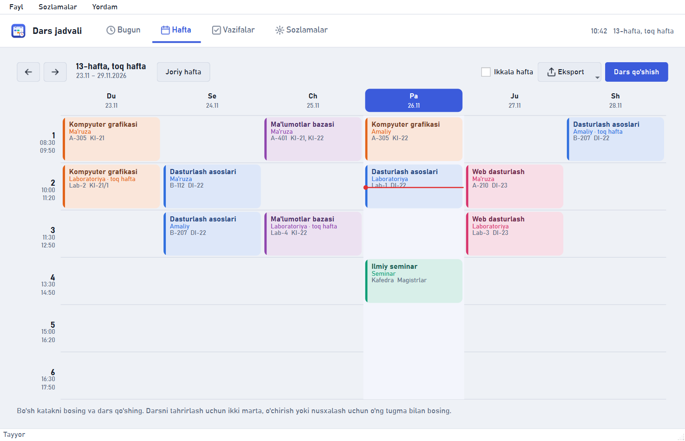
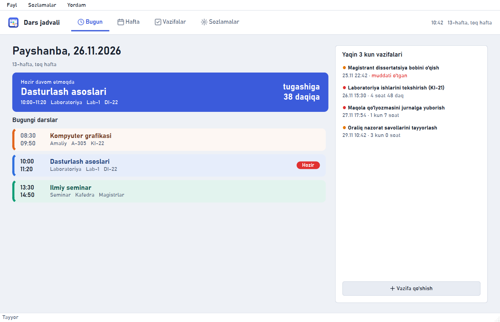
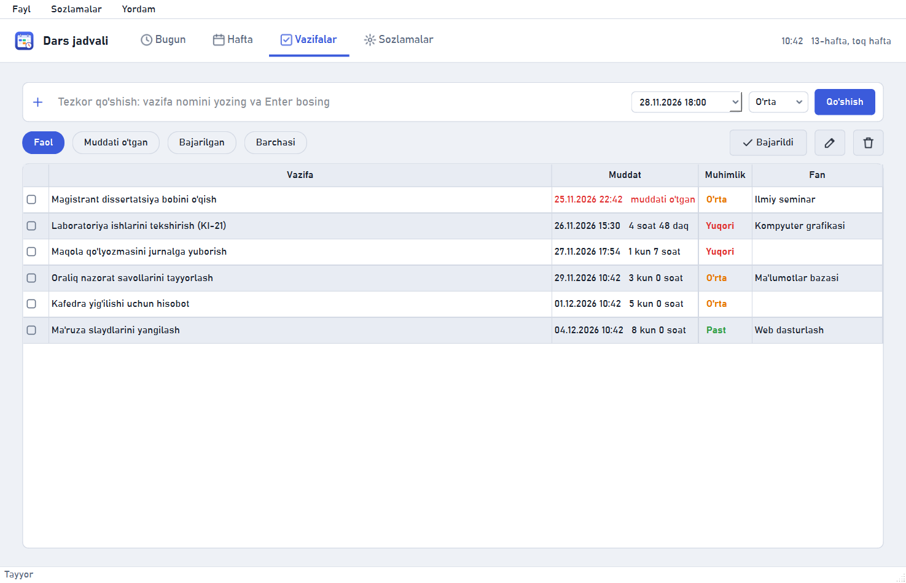
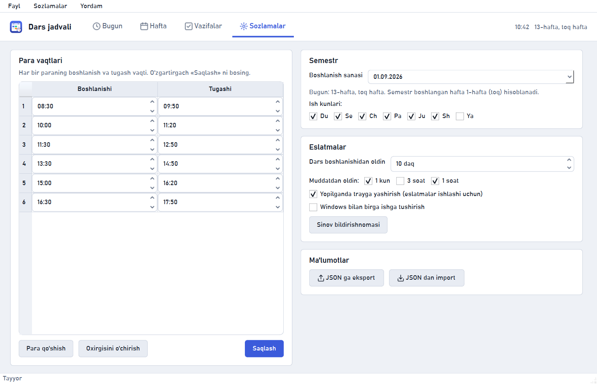

UDK: 004.42:378.14

# Oliy ta’lim o‘qituvchisi uchun toq va juft haftalarni hisobga oluvchi dars jadvali hamda muddatlar eslatuvchisining oflayn dasturiy vositasi

**Hakimov Bahtiyorjon**  
*[ish joyi, lavozimi, elektron pochta]*

**Annotatsiya.** Maqolada oliy ta’lim muassasasi o‘qituvchisining haftalik dars jadvalini yuritish va vazifalar muddatini nazorat qilish uchun yaratilgan “Dars jadvali va deadline eslatuvchisi” dasturiy vositasi tavsiflanadi. Dastur Python 3.12 va PySide6 asosida yaratilgan va internetsiz ishlaydi. Unda sozlanadigan para vaqtlari, semestr boshlanish sanasidan hafta raqami va toq yoki juft haftani avtomatik hisoblash, fan, dars turi, xona va guruh ko‘rsatilgan rangli hafta to‘ri, joriy yoki keyingi darsgacha qolgan vaqtni ko‘rsatuvchi “Bugun” sahifasi, muhimlik va muddatli vazifalar ro‘yxati, dars va muddat oldidan Windows bildirishnomalari, jadvalni PDF va PNG formatlariga eksport qilish va JSON orqali zaxiralash amalga oshirilgan. Ishonchlilik 23 ta avtomatik test bilan tekshirilgan.

*Kalit so‘zlar:* dars jadvali, toq va juft hafta, vaqtni boshqarish, muddat eslatmasi, o‘qituvchi ish vaqti, bildirishnoma, oflayn dastur.

**Офлайн-программное средство расписания занятий с учётом чётных и нечётных недель и напоминаний о сроках для преподавателя вуза**

**Аннотация.** В статье описывается программное средство «Расписание занятий и напоминание о сроках», предназначенное для ведения недельного расписания преподавателя вуза и контроля сроков задач. Программа разработана на Python 3.12 и PySide6 и работает без интернета. Реализованы настраиваемое время пар, автоматический расчёт номера недели и её чётности от даты начала семестра, цветная недельная сетка с предметом, типом занятия, аудиторией и группой, страница «Сегодня» с оставшимся временем до текущего или следующего занятия, список задач с приоритетом и сроком, уведомления Windows перед занятием и сроком, экспорт расписания в PDF и PNG и резервное копирование через JSON. Надёжность проверена 23 автоматическими тестами.

*Ключевые слова:* расписание занятий, чётная и нечётная неделя, управление временем, напоминание о сроках, рабочее время преподавателя, уведомление, офлайн-приложение.

**An offline software tool for an odd/even-week class timetable and deadline reminders for university teachers**

**Abstract.** The paper describes the Class Timetable and Deadline Reminder, a software tool for maintaining a university teacher’s weekly timetable and tracking task deadlines. The program is written in Python 3.12 with PySide6 and works offline. It offers configurable class periods, automatic computation of the week number and its odd or even parity from the semester start date, a colour-coded weekly grid showing subject, class type, room and group, a Today page with the time left until the current or next class, a task list with priorities and deadlines, Windows notifications before classes and deadlines, export of the timetable to PDF and PNG, and JSON backup. Reliability is verified by 23 automated tests.

*Keywords:* class timetable, odd and even week, time management, deadline reminder, teacher workload, notification, offline application.

## Kirish

Oliy ta’lim muassasasi o‘qituvchisining ish vaqti auditoriya mashg‘ulotlari, ilmiy, o‘quv-uslubiy va tashkiliy ishlardan iborat. Auditoriya mashg‘ulotlari odatda haftalik jadval asosida o‘tadi, biroq ko‘plab muassasalarda jadval toq va juft haftalarga bo‘lingan: ayrim darslar har hafta, boshqalari faqat toq yoki faqat juft haftalarda o‘tkaziladi. Bundan tashqari, bir o‘qituvchi bir nechta fan bo‘yicha turli guruhlarda ma’ruza, amaliy, laboratoriya va seminar mashg‘ulotlarini olib boradi, ular turli binolar va xonalarda bo‘lishi mumkin.

Jadval bilan bir qatorda o‘qituvchi muddatli vazifalarni ham bajaradi: laboratoriya ishlarini tekshirish, oraliq va yakuniy nazorat savollarini tayyorlash, maqolani jurnalga yuborish, magistrant dissertatsiyasining bobini o‘qish, kafedra yig‘ilishi uchun hisobot tayyorlash va hokazo. Bunday vazifalar jadvaldan alohida yuritilsa, ular orasidagi bog‘liqlik yo‘qoladi va muddatni o‘tkazib yuborish ehtimoli ortadi.

Amaliyotda jadval ko‘pincha qog‘ozda yoki umumiy jadval faylida saqlanadi, joriy hafta toq yoki juft ekanligi esa qo‘lda hisoblanadi. Semestr o‘rtasida, ayniqsa bayram kunlari va yangi yil arafasida, hafta raqamini hisoblashda xato qilish oson. Umumiy elektron kalendarlar toq va juft hafta tushunchasini bevosita qo‘llab-quvvatlamaydi, para vaqtlari bilan ishlash uchun esa har bir darsni alohida voqea sifatida kiritishni talab qiladi.

Ta’lim tizimini raqamlashtirish, jumladan “Raqamli O‘zbekiston – 2030” strategiyasida belgilangan vazifalar, o‘qituvchining kundalik ishini tashkil etishni qo‘llab-quvvatlovchi mahalliy dasturiy vositalarga ehtiyojni oshiradi. Ushbu maqolada shunday vositalardan biri – “Dars jadvali va deadline eslatuvchisi” dasturining vazifasi, arxitekturasi, asosiy algoritmlari va sinov natijalari bayon etiladi.

Dastur birinchi navbatda o‘qituvchi uchun mo‘ljallangan bo‘lsa-da, uning ma’lumot modeli talaba va magistrant ehtiyojlariga ham mos keladi: talaba o‘z guruhi jadvalini kiritib, laboratoriya ishlarini topshirish, referat va kurs ishi muddatlarini shu dasturda kuzatishi mumkin. Shu sababli vosita ta’lim jarayonining ikki tomoni – o‘qituvchi va o‘quvchi uchun ham vaqtni tashkil etish quroli sifatida qaraladi.

## Muammoning qo‘yilishi va mavjud yechimlar tahlili

Tadqiqot maqsadi – o‘qituvchining haftalik dars jadvalini toq va juft haftalarni hisobga olgan holda yurituvchi, joriy va keyingi darsni ko‘rsatuvchi, muddatli vazifalarni boshqaruvchi va dars hamda muddat oldidan eslatma beruvchi oflayn ish stoli ilovasini ishlab chiqish. Bu maqsad quyidagi vazifalarga ajratildi:

- para vaqtlari va ish kunlarini sozlanadigan qilish hamda ularning to‘g‘riligini (tugash vaqti boshlanishidan keyin, paralar ustma-ust tushmasligi) tekshirish;
- semestr boshlanish sanasidan joriy hafta raqami va toq yoki juftligini hisoblash;
- darsni fan, turi, guruh, xona, kun, para va haftalar rejimi (har hafta, faqat toq, faqat juft) bilan saqlash;
- haftalik jadvalni ko‘rgazmali rangli to‘r ko‘rinishida chiqarish;
- joriy yoki keyingi darsni va unga qadar qolgan vaqtni ko‘rsatish;
- vazifalarni muddat va muhimlik bilan yuritish, ularni holatiga ko‘ra filtrlash;
- dars boshlanishidan va vazifa muddatidan oldin tizim bildirishnomasi chiqarish, bunda bitta eslatmani takror ko‘rsatmaslik;
- jadvalni chop etish, PDF va PNG formatlariga eksport qilish, barcha ma’lumotlarni zaxiralash va ko‘chirish.
Mavjud yechimlarni umumiy turlarga ajratish mumkin. Birinchi tur – muassasa miqyosidagi jadval tuzish tizimlari. Ular butun fakultet yoki universitet jadvalini tuzish va xonalarni taqsimlash uchun mo‘ljallangan, o‘qituvchining shaxsiy vazifalari va eslatmalarini boshqarmaydi va ko‘pincha internet orqali ishlaydi. Ikkinchi tur – umumiy maqsadli elektron kalendarlar va vazifalar menejerlari. Ular voqealar va eslatmalar bilan yaxshi ishlaydi, biroq para tushunchasi, toq va juft haftalar, dars turi va guruh kabi ta’limga xos tushunchalarni bevosita qo‘llab-quvvatlamaydi. Uchinchi tur – jadval fayllari va qog‘oz jadvallar: ular moslashuvchan, ammo avtomatik hisoblash va eslatma imkoniyatiga ega emas.

Shu sababli ishlab chiqiladigan vosita uchun quyidagi talablar shakllantirildi: o‘rnatishsiz ishga tushadigan bitta fayl; internetsiz ishlash; o‘qituvchi tilida (o‘zbek, rus, ingliz) interfeys; ta’limga xos tushunchalar (para, dars turi, toq va juft hafta) asosidagi ma’lumot modeli; oyna yopilganda ham eslatmalarning ishlashi; foydalanuvchi ruxsatisiz tizim sozlamalariga (masalan, avtomatik ishga tushirishga) tegmaslik.

Yechimning sifat mezonlari ham belgilandi: hafta raqami va juftligi har qanday sana uchun, jumladan yil chegarasida va semestr boshlanishidan oldin, to‘g‘ri hisoblanishi; har bir eslatma faqat bir marta, belgilangan vaqtda chiqishi; noto‘g‘ri yoki buzilgan ma’lumot fayli dasturni ishdan chiqarmasligi; import qilingan ma’lumotlar mavjud ma’lumotlarni buzmasligi. Sinov tizimi aynan shu mezonlarni tekshirishga yo‘naltirilgan.

## Tadqiqot metodologiyasi va dasturiy arxitektura

Dastur Python 3.12 tilida yozilgan, grafik interfeys Qt 6 asosidagi PySide6 kutubxonasida yaratilgan. Hafta to‘ri Qt’ning QPainter grafik vositalari bilan chiziladi, chop etish va PDF eksport Qt chop etish moduli orqali, bildirishnomalar esa tizim tepsisidagi belgi (QSystemTrayIcon) orqali amalga oshiriladi. Dastur PyInstaller yordamida bitta .exe faylga yig‘iladi. Uchinchi tomon komponentlari va litsenziyalari THIRD PARTY NOTICES hujjatida keltirilgan.

Kod quyidagi modullarga ajratilgan:

- **schedule** – ma’lumot modeli va mantiq: para vaqtlari, hafta raqami va juftligi, darsning berilgan kunda o‘tkazilishi, keyingi dars, eslatmalarni hisoblash, vazifalar holati va filtrlari, fan rangini tanlash, ma’lumotlarni tekshirish, birlashtirish va saqlash;
- **grid** – hafta to‘rini chizish va undagi bosishlarni qayta ishlash;
- **ui extra** moduli – tizim tepsisi, avtomatik ishga tushirish, belgilar va yordamchi interfeys elementlari;
- **window** – asosiy oyna va to‘rtta sahifa: “Bugun”, “Hafta”, “Vazifalar”, “Sozlamalar”;
- **strings** – o‘zbek, rus va ingliz tilidagi interfeys matnlari;
- **uzkit** – menyu, til, mavzu, sozlamalar va fayl yo‘llari uchun umumiy karkas.
Ma’lumot modeli. Barcha ma’lumotlar bitta JSON hujjatda saqlanadi: format versiyasi, para vaqtlari ro‘yxati (har biri boshlanish va tugash vaqti bilan), ish kunlari, semestr boshlanish sanasi, darslar, vazifalar va keyingi identifikator. Standart holatda oltita para belgilangan: 08:30–09:50, 10:00–11:20, 11:30–12:50, 13:30–14:50, 15:00–16:20 va 16:30–17:50; ish kunlari – dushanbadan shanbagacha. Semestr boshlanish sanasi standart holatda kuzgi semestr uchun 1-sentabr, bahorgi semestr uchun 1-fevral qilib olinadi va sozlamalarda o‘zgartiriladi. Dars yozuvi fan nomi, turi (ma’ruza, amaliy, laboratoriya, seminar), guruh(lar), xona, hafta kuni, para raqami, haftalar rejimi, rang va izohdan iborat. Vazifa yozuvi nomi, muddati (sana va vaqt), muhimligi (past, o‘rta, yuqori), bog‘langan fan va bajarilganlik belgisidan iborat. Sana va vaqtlar ISO 8601 ko‘rinishida saqlanadi.

Hafta raqami va juftligi. Hafta raqami semestr boshlanish sanasi tushgan haftaning dushanbasi va berilgan sana haftasining dushanbasi orasidagi kunlar sonini yettiga bo‘lib, birni qo‘shish orqali hisoblanadi. Shunday qilib semestr boshlangan hafta 1-hafta (toq) hisoblanadi, hafta yil chegarasidan o‘tganda ham hisob uzilmaydi. Toq raqamli hafta “toq”, juft raqamli hafta “juft” deb belgilanadi; semestr boshlanishidan oldingi sanalar uchun ham hisob to‘g‘ri ishlaydi. Dars berilgan sanada o‘tkazilishi uchun uning hafta kuni mos kelishi, haftalar rejimi esa “har hafta” bo‘lishi yoki hafta juftligiga mos kelishi kerak.

Keyingi dars va eslatmalar. Keyingi dars joriy vaqtdan boshlab o‘n to‘rt kunlik oraliqda qidiriladi; agar dars hozir davom etayotgan bo‘lsa, u “Hozir davom etmoqda” holatida tugashigacha qolgan vaqt bilan ko‘rsatiladi. Dars eslatmasi dars boshlanishidan foydalanuvchi belgilagan daqiqalar (standart holatda 10 daqiqa) oldin, vazifa eslatmasi esa muddatdan 1 kun, 3 soat yoki 1 soat oldin (standart holatda 1 kun va 1 soat) chiqariladi. Har bir eslatma noyob kalit bilan belgilanadi va ko‘rsatilgan eslatmalar alohida faylda saqlanadi, shuning uchun dastur qayta ishga tushirilganda ham bir xil eslatma takrorlanmaydi; bu ro‘yxat oxirgi 3000 ta yozuv bilan cheklanadi.

Fan ranglari. Har bir fan uchun rang fan nomidan barqaror ravishda 12 ta rangli palitradan tanlanadi, shu sababli bir fanning barcha darslari jadvalda bir xil rangda ko‘rinadi. Foydalanuvchi darsga rangni qo‘lda ham belgilashi mumkin.

Vazifalar holati. Har bir vazifa uchun holat joriy vaqtga nisbatan aniqlanadi: bajarilgan, muddati o‘tgan yoki faol. Faol vazifalar muddatigacha qolgan vaqt “kun va soat”, “soat va daqiqa” yoki “daqiqa” ko‘rinishida ko‘rsatiladi, muhimlik esa rang bilan ajratiladi (past – yashil, o‘rta – to‘q sariq, yuqori – qizil). Filtrlar shu holatlar asosida ro‘yxatni tanlaydi, ro‘yxat esa muddat bo‘yicha tartiblanadi.

Saqlash, import va xavfsizlik. Ma’lumotlar foydalanuvchi profilidagi %APPDATA%\BahtiyorSoft\dars-jadvali papkasida saqlanadi. Yozish vaqtinchalik faylga bajarilib, so‘ng asl fayl o‘rniga almashtiriladi. Fayl buzilgan bo‘lsa, u alohida nom bilan zaxiraga ko‘chiriladi va dastur standart ma’lumotlar bilan ishga tushadi. Yuklangan va import qilingan ma’lumotlar tekshiriladi: noto‘g‘ri yozuvlar e’tiborga olinmaydi. JSON importda mavjud ma’lumotlarga qo‘shish yoki ularni almashtirish tanlanadi; qo‘shishda takroriy darslar (fan, kun, para, haftalar rejimi va guruh bir xil) va takroriy vazifalar (nom va muddat bir xil) o‘tkazib yuboriladi. Dastur internetga murojaat qilmaydi. Windows bilan birga ishga tushirish faqat foydalanuvchi bayroqni belgilaganda yoqiladi va joriy foydalanuvchining avtoyuklash ro‘yxatiga yoziladi.

Ma’lumot oqimi va vaqt nazorati. Asosiy oynada har 30 soniyada ishlovchi taymer mavjud. U har safar joriy vaqtni yangilaydi, “Bugun” sahifasidagi qolgan vaqtni qayta hisoblaydi va eslatma shartlarini tekshiradi: dars boshlanishi yoki vazifa muddati belgilangan oraliqqa kirgan bo‘lsa va bu eslatma hali ko‘rsatilmagan bo‘lsa, tizim bildirishnomasi chiqariladi, eslatma kaliti esa ko‘rsatilganlar ro‘yxatiga yoziladi. Dastur ishga tushgandan bir necha soniya o‘tib ham tekshiruv bajariladi. Foydalanuvchi dars yoki vazifani o‘zgartirganda ma’lumotlar darhol diskka saqlanadi va barcha sahifalar yangilanadi.

Hafta to‘rini chizish. To‘r bitta chizish funksiyasi orqali ekranda, PDF faylda, PNG rasmda va chop etishda bir xil tarzda chiziladi; chop etish rejimida ranglar va o‘lchamlar qog‘ozga moslashtiriladi. Kartochkadagi matn katak kengligiga qarab qatorlarga bo‘linadi, joy yetmasa qisqartiriladi. Bunday yondashuv ekranda ko‘rilgan jadval bilan eksport qilingan faylning bir xil bo‘lishini ta’minlaydi.

## Amalga oshirish va asosiy funksiyalar

Asosiy oyna yuqorisida dastur nomi, to‘rtta sahifa yorlig‘i (“Bugun”, “Hafta”, “Vazifalar”, “Sozlamalar”) va o‘ng burchakda joriy vaqt hamda hafta raqami (masalan, “13-hafta, toq hafta”) joylashgan.

“Hafta” sahifasi (1-rasm) haftalik rangli to‘rni ko‘rsatadi: ustunlar ish kunlari, qatorlar paralar bo‘lib, har bir qator yonida para raqami va vaqti yozilgan. Har bir dars kartochkasida fan nomi, turi, haftalar rejimi (agar faqat toq yoki juft bo‘lsa), xona va guruh ko‘rsatiladi. Joriy kun ustuni ajratib ko‘rsatiladi, joriy vaqt esa qizil chiziq bilan belgilanadi. Strelkalar bilan oldingi va keyingi haftalarga o‘tiladi, “Joriy hafta” tugmasi bugungi haftaga qaytaradi, “Ikkala hafta” bayrog‘i toq va juft haftalardagi darslarni birga ko‘rsatadi. Bo‘sh katakni bosish yangi dars qo‘shish oynasini ochadi, darsni ikki marta bosish uni tahrirlaydi, sichqonchaning o‘ng tugmasi nusxa olish va o‘chirish menyusini chiqaradi. “Eksport” menyusi jadvalni PDF ga, PNG rasmga saqlaydi yoki chop etadi. Interfeysning qorong‘i mavzusi 4-rasmda ko‘rsatilgan.

“Bugun” sahifasi (2-rasm) sana va hafta ma’lumoti, joriy yoki keyingi dars bloki (fan, vaqt, turi, xona, guruh va boshlanishiga yoki tugashiga qolgan vaqt), “Bugungi darslar” ro‘yxati (“Hozir” va “Keyingi” belgilari bilan) hamda “Yaqin 3 kun vazifalari” panelini o‘z ichiga oladi. Muddati o‘tgan vazifalar qizil rangda “muddati o‘tgan” deb belgilanadi.

“Vazifalar” sahifasi (3-rasm) yuqorisida tezkor qo‘shish maydoni joylashgan: vazifa nomini yozib Enter bosish kifoya, muddat va muhimlik yonidagi maydonlarda tanlanadi. To‘liq tahrirlash oynasi Ctrl+N orqali ochiladi. Vazifalar “Faol”, “Muddati o‘tgan”, “Bajarilgan” va “Barchasi” filtrlari bo‘yicha ko‘riladi; jadvalda vazifa nomi, muddati va qolgan vaqt, muhimlik va bog‘langan fan ko‘rsatiladi. Vazifani bajarilgan deb belgilash chap ustundagi katakcha, “Bajarildi” tugmasi yoki probel tugmasi orqali amalga oshiriladi.

“Sozlamalar” sahifasi (5-rasm) “Para vaqtlari” jadvalini (“Para qo‘shish”, “Oxirgisini o‘chirish”, “Saqlash”), “Semestr” bo‘limini (boshlanish sanasi, joriy hafta haqida ma’lumot va ish kunlari), “Eslatmalar” bo‘limini (dars boshlanishidan necha daqiqa oldin, muddatdan oldin 1 kun, 3 soat, 1 soat bayroqlari, “Yopilganda trayga yashirish (eslatmalar ishlashi uchun)”, “Windows bilan birga ishga tushirish”, “Sinov bildirishnomasi” tugmasi) va “Ma’lumotlar” bo‘limini (“JSON ga eksport”, “JSON dan import”) o‘z ichiga oladi. Para vaqtlari saqlanganda tugash vaqti boshlanishidan keyin ekanligi va paralar ustma-ust tushmasligi tekshiriladi; olib tashlanayotgan paralarda darslar bo‘lsa, foydalanuvchidan tasdiq so‘raladi.

Oyna yopilganda dastur standart holatda tizim tepsisida ishlashda davom etadi va eslatmalarni ko‘rsatadi; tepsi menyusida “Ochish” va “Dasturdan chiqish” bandlari bor. Dars qo‘shish uchun Ctrl+L tezkor tugmasi ham mavjud.

Odatiy ish ssenariysi quyidagicha. Semestr boshida o‘qituvchi para vaqtlari va semestr sanasini sozlaydi, fakultet jadvalidan o‘z darslarini kiritadi, so‘ng asosiy muddatlarni vazifalar ro‘yxatiga qo‘shadi. Kundalik ishda u “Bugun” sahifasini ochib, navbatdagi dars xonasi va guruhini ko‘radi; dars boshlanishidan o‘n daqiqa oldin bildirishnoma oladi; yangi topshiriqni tezkor qo‘shish maydoni orqali bir necha soniyada yozib qo‘yadi. Semestr oxirida u ma’lumotlarni JSON ga eksport qilib, keyingi semestr uchun asos sifatida saqlaydi.

Talaba uchun ssenariy shunga o‘xshash: u guruh jadvalini kiritadi, har bir fan bo‘yicha topshiriqlar muddatini vazifalar ro‘yxatiga qo‘shadi va “Bugun” sahifasida navbatdagi darsni hamda yaqin uch kundagi topshiriqlarni bir qarashda ko‘radi.

*1-rasm. “Hafta” sahifasi (yorug‘ mavzu): 13-hafta (toq hafta) uchun rangli dars to‘ri, olti para va ish kunlari bo‘yicha fan, turi, xona va guruh ko‘rsatilgan; joriy kun ajratilgan, joriy vaqt qizil chiziq bilan belgilangan*

*2-rasm. “Bugun” sahifasi: “Hozir davom etmoqda” bloki va tugashiga qolgan vaqt, “Bugungi darslar” ro‘yxati, o‘ngda “Yaqin 3 kun vazifalari”*

*3-rasm. “Vazifalar” sahifasi: tezkor qo‘shish maydoni, “Faol”, “Muddati o‘tgan”, “Bajarilgan”, “Barchasi” filtrlari, vazifalar jadvali muddat, qolgan vaqt, muhimlik va fan bilan*

*4-rasm. “Sozlamalar” sahifasi: “Para vaqtlari” jadvali, “Semestr” boshlanish sanasi va ish kunlari, “Eslatmalar” va “Ma’lumotlar” bo‘limlari*

## Sinov va natijalar

Dasturning to‘g‘riligi pytest asosidagi 23 ta avtomatik test funksiyasi bilan tekshiriladi.

- **Jadval mantig‘i testlari (12 ta).** Hafta raqami va juftligi; toq va juft haftalardagi darslarning o‘tkazilishi; keyingi va davom etayotgan darsni aniqlash; dars eslatmalari; muddat eslatmalari; vazifalarni filtrlash; ma’lumotlarni tekshirish va birlashtirishdan keyin qayta tiklash; saqlash va yuklash; fan rangining barqarorligi; semestr boshlanishining standart sanasi; PDF va PNG eksport; interfeysdagi asosiy ish oqimlari.
- **Ssenariy testlari (9 ta).** Ikki hafta davomida har daqiqada dars eslatmalarini modellashtirish (har bir eslatma bir marta chiqishini tekshirish); muddat eslatmalarini daqiqama-daqiqa modellashtirish; yangi yil va semestr chegaralarida hafta juftligi; buzilgan ma’lumot faylining zaxiraga ko‘chirilishi; noto‘g‘ri import fayllarini rad etish; soxta soat bilan interfeys eslatmalari; noto‘g‘ri eslatma sozlamalarida dasturning buzilmasligi; noto‘g‘ri turdagi sozlamalar bilan ishga tushish; buzilgan sozlamalar faylini tiklash.
- **Tutun testlari (2 ta).** Asosiy oynaning yaratilishi va uch tildagi tarjimalarning to‘liqligi.
Funksional ko‘rsatkichlar: sozlanadigan paralar soni (standart holatda 6 ta); 4 turdagi mashg‘ulot; 3 xil haftalar rejimi; 3 darajali muhimlik; 4 ta vazifa filtri; dars eslatmasi vaqti va muddat oldidan 3 ta eslatma varianti; eksport formatlari – PDF, PNG va chop etish; zaxiralash formati – JSON. Interfeys tillari – o‘zbek, rus va ingliz. Dastur Windows 10 (1809 va undan keyingi) va Windows 11 x64 tizimlarida o‘rnatishsiz ishlaydi.

Eslatma mantiqi soxta soat yordamida minutma-minut modellashtirilgani algoritmning vaqtga bog‘liq qismlarini real vaqt kutmasdan tekshirish imkonini berdi. Ish tezligi, foydalanuvchilar soni yoki foydalanuvchilar fikri bo‘yicha o‘lchovlar o‘tkazilmagan, shuning uchun bunday ko‘rsatkichlar keltirilmaydi.

Testlar dastur manba kodi bilan birga saqlanadi va har bir versiyani yig‘ishdan oldin ishga tushiriladi. Interfeys testlari Qt oynasini ekranga chiqarmasdan yaratadi va vaqtni soxta soat orqali boshqaradi, shuning uchun “Bugun” sahifasi va eslatmalar turli vaqt holatlarida tekshiriladi.

## Muhokama

Dasturning asosiy afzalliklari quyidagilardan iborat. Birinchidan, ma’lumot modeli ta’limga xos tushunchalar – para, dars turi, guruh, xona, toq va juft hafta – asosida qurilgan, shuning uchun o‘qituvchi jadvalni universitet jadvalidagi ko‘rinishda bevosita kiritadi. Ikkinchidan, hafta raqami va juftligi semestr boshlanish sanasidan avtomatik hisoblanadi, bu esa qo‘lda hisoblash bilan bog‘liq xatolarni bartaraf etadi. Uchinchidan, jadval va vazifalar bitta dasturda birlashtirilgan: vazifani fan bilan bog‘lash, “Bugun” sahifasida darslar va yaqin vazifalarni birga ko‘rish mumkin. To‘rtinchidan, eslatmalar takrorlanmasligi va oyna yopilganda ham ishlashi ta’minlangan. Beshinchidan, ma’lumotlar faqat foydalanuvchi kompyuterida saqlanadi va internetga bog‘liq emas.

Cheklovlar ham mavjud. Eslatmalar faqat dastur ochiq yoki tizim tepsisida ishlab turganda chiqadi; kompyuter o‘chiq bo‘lsa yoki dastur to‘liq yopilgan bo‘lsa, eslatma ko‘rsatilmaydi. Dastur bir foydalanuvchiga mo‘ljallangan va ma’lumotlarni boshqa qurilmalar bilan avtomatik sinxronlamaydi; ko‘chirish JSON eksport va import orqali qo‘lda bajariladi. Bayram kunlari va jadval o‘zgarishlari (dars ko‘chirilishi) alohida tushuncha sifatida modellashtirilmagan. Muassasa jadval tizimidan avtomatik import ham mavjud emas.

Shuningdek, dastur muassasa miqyosidagi jadval tuzish tizimining o‘rnini bosmaydi: u xonalar bandligini, o‘qituvchilar orasidagi to‘qnashuvlarni va o‘quv rejasi bo‘yicha soatlar taqsimotini tekshirmaydi. Uning vazifasi – tayyor jadvalni alohida o‘qituvchi yoki talabaning shaxsiy ish vositasiga aylantirish.

Rivojlantirish istiqbollari sifatida dam olish kunlari va bir martalik o‘zgarishlarni hisobga olish, dars yuklamasi bo‘yicha statistik hisobotlar (masalan, fan va dars turi bo‘yicha soatlar), jadvalni standart kalendar formatlariga eksport qilish va guruh sardorlari bilan jadvalni almashish imkoniyatlarini ko‘rsatish mumkin.

O‘quv jarayoni nuqtai nazaridan dastur vaqtni boshqarish va pedagogik mahorat fanlarida ko‘rgazmali vosita bo‘la oladi: u rejalashtirishning asosiy tushunchalarini (muhimlik, muddat, eslatma, zaxiralash) real ish vaziyatida ko‘rsatadi. Informatika fanida esa dastur JSON formatidagi ma’lumotlar, tizim bildirishnomalari va avtomatik ishga tushirish kabi mavzularni amaliy misolda tushuntirish imkonini beradi.

## Xulosa

Ishda oliy ta’lim o‘qituvchisi uchun dars jadvali va muddatlarni boshqarishning oflayn dasturiy vositasi taqdim etildi. Ta’limga xos ma’lumot modeli, semestr boshidan hafta raqami va juftligini hisoblash algoritmi, rangli hafta to‘ri, joriy va keyingi darsni aniqlash, takrorlanmaydigan dars va muddat eslatmalari, PDF va PNG eksport hamda JSON orqali zaxiralash amalga oshirildi.

Vositaning funksional to‘g‘riligi 23 ta avtomatik test bilan, jumladan eslatmalarni ikki hafta davomida daqiqama-daqiqa modellashtirish orqali tasdiqlangan. Modulli arxitektura jadval mantig‘ini interfeysdan ajratgani tufayli yangi imkoniyatlar, masalan, dam olish kunlarini hisobga olish yoki yuklama hisobotlari, mavjud kodga katta o‘zgartirish kiritmasdan qo‘shilishi mumkin. Dastur o‘qituvchiga jadvalni bir joyda yuritish, darsga o‘z vaqtida tayyorlanish va muddatli ishlarni nazorat qilishda yordam beradi, talabalar va magistrantlar uchun esa o‘quv vaqtini rejalashtirish vositasi bo‘lib xizmat qilishi mumkin.

## Foydalanilgan adabiyotlar

1. Python Software Foundation. Python 3.12 Documentation [Elektron resurs]. – URL: https://docs.python.org/3.12/ (murojaat sanasi: 27.11.2026).
2. The Qt Company. Qt for Python (PySide6) Documentation [Elektron resurs]. – URL: https://doc.qt.io/qtforpython-6/ (murojaat sanasi: 27.11.2026).
3. The Qt Company. QSystemTrayIcon Class. Qt 6 Documentation [Elektron resurs]. – URL: https://doc.qt.io/qt-6/qsystemtrayicon.html (murojaat sanasi: 27.11.2026).
4. The Qt Company. QPainter Class. Qt 6 Documentation [Elektron resurs]. – URL: https://doc.qt.io/qt-6/qpainter.html (murojaat sanasi: 27.11.2026).
5. PyInstaller Development Team. PyInstaller Manual [Elektron resurs]. – URL: https://pyinstaller.org/en/stable/ (murojaat sanasi: 27.11.2026).
6. ISO 8601-1:2019. Date and time – Representations for information interchange – Part 1: Basic rules. – Geneva : ISO, 2019.
7. Microsoft. Run and RunOnce Registry Keys [Elektron resurs]. – URL: https://learn.microsoft.com/en-us/windows/win32/setupapi/run-and-runonce-registry-keys (murojaat sanasi: 27.11.2026).
8. O‘zbekiston Respublikasi Prezidentining 2020-yil 5-oktabrdagi PF-6079-son “Raqamli O‘zbekiston – 2030” strategiyasini tasdiqlash va uni samarali amalga oshirish chora-tadbirlari to‘g‘risida”gi Farmoni.
9. Hakimov B. dars-jadvali: dastur manba kodi va relizlari [Elektron resurs]. – URL: https://github.com/eduhakimov/dars-jadvali (murojaat sanasi: 27.11.2026).
