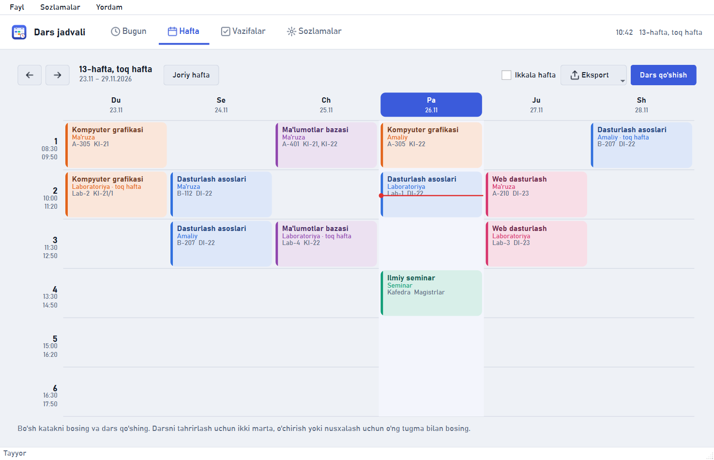
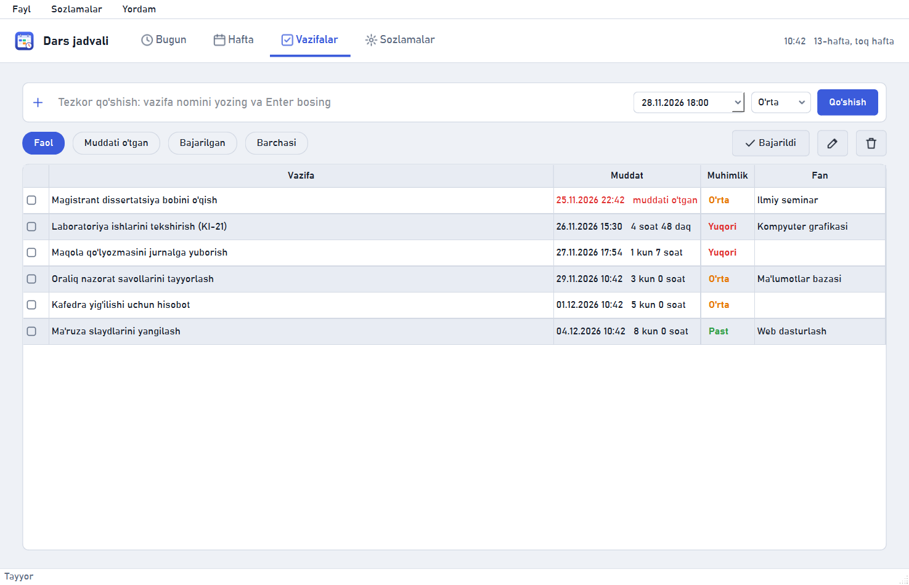

# Dars jadvali va deadline eslatuvchisi: Uslubiy ko‘rsatma

Muallif: Hakimov Bahtiyorjon. Versiya: 1.0.2.

## 1. Uslubiy ko‘rsatmaning maqsadi va vazifalari

Ushbu uslubiy ko‘rsatma “Dars jadvali va deadline eslatuvchisi” dasturidan oliy ta’lim muassasalari, kollej va texnikumlar o‘qituvchilari, kafedra xodimlari hamda talabalarning o‘quv va kasbiy faoliyatida foydalanish tartibini belgilaydi.

Maqsad – o‘qituvchi va talabalarda vaqtni rejalashtirish, dars jadvali va muddatli vazifalarni tizimli yuritish, raqamli vositalar yordamida o‘z ish vaqtini boshqarish ko‘nikmalarini shakllantirish.

Vazifalar:

- dars jadvalining tuzilishi (para, kun, haftalar rejimi, dars turi) va semestr kalendari bilan tanishtirish;
- toq va juft haftalarni hisoblash tamoyilini tushuntirish;
- muddatli vazifalarni muhimlik va muddat bo‘yicha rejalashtirishni o‘rgatish;
- eslatmalar va bildirishnomalardan oqilona foydalanishni ko‘rsatish;
- ma’lumotlarni zaxiralash, eksport va import qilish madaniyatini shakllantirish.
Ko‘rsatma mashg‘ulot rejasi, amaliy topshiriqlar, baholash mezonlari va nazorat savollarini o‘z ichiga oladi va fan dasturiga moslab qo‘llanishi mumkin.

Mashg‘ulotlar natijasida talaba quyidagilarni bilishi va bajara olishi kutiladi: semestr kalendaridagi hafta raqami va juftligini hisoblay olish; dars jadvalini raqamli ko‘rinishda to‘liq va xatosiz kiritish; muddatli vazifalarni muhimlik bo‘yicha rejalashtirish; eslatmalarni o‘z ish uslubiga moslab sozlash; ma’lumotlarni zaxiralash va boshqa kompyuterga ko‘chirish.

## 2. Qo‘llash sohasi va maqsadli auditoriya

Dasturdan quyidagi fanlar va faoliyat turlarida foydalanish tavsiya etiladi:

- “Pedagogik mahorat”, “Oliy ta’lim pedagogikasi” fanlarida o‘qituvchi ish vaqtini tashkil etish mavzusi;
- “Vaqtni boshqarish”, “Shaxsiy samaradorlik”, “Menejment asoslari” fanlari;
- “Informatika va axborot texnologiyalari” fanida ish stoli ilovalari, ma’lumotlar formati (JSON) va bildirishnomalar mavzulari;
- malaka oshirish kurslarida yosh o‘qituvchilar uchun raqamli vositalar mashg‘ulotlari;
- talabalarning mustaqil ta’limini rejalashtirish bo‘yicha kuratorlik soatlari.
Maqsadli auditoriya: oliy ta’lim, kollej va texnikum o‘qituvchilari, kafedra mudirlari va metodistlari, tayanch doktorantlar va magistrantlar (assistentlik amaliyoti davrida), shuningdek talabalar.

Kasbiy faoliyatda dastur o‘qituvchining shaxsiy jadvalini yuritish, laboratoriya ishlarini tekshirish, nazorat savollarini tayyorlash va hisobot topshirish muddatlarini kuzatish uchun qo‘llanadi. Kafedra mudiri esa jadvalni PDF ko‘rinishida eksport qilib, kafedra stendiga yoki xodimlar bilan muhokama uchun foydalanishi mumkin.

Dastur o‘zbek, rus va ingliz tilidagi interfeysga ega bo‘lgani uchun turli ta’lim tillaridagi guruhlarda qo‘llanishi mumkin. Malaka oshirish kurslarida u yosh o‘qituvchilarga semestr davomida auditoriya va auditoriyadan tashqari yuklamani rejalashtirishni o‘rgatish uchun amaliy vosita bo‘lib xizmat qiladi.

## 3. O‘quv mashg‘ulotida foydalanish tartibi

Quyida 80 daqiqalik amaliy mashg‘ulot rejasi keltirilgan. Mashg‘ulot kompyuter sinfida o‘tkaziladi, har bir kompyuterda dastur nusxasi bo‘ladi. O‘qituvchi oldindan namunaviy jadval (fakultet jadvalidan bir haftalik ko‘chirma) va vazifalar ro‘yxatini tarqatma material sifatida tayyorlaydi, shuningdek namunaviy JSON faylni tayyorlab qo‘yadi.

**Tashkiliy qism (5 daqiqa).** Davomat, mavzu va maqsadni e’lon qilish, tarqatma materialni berish.

Mashg‘ulotning kutilgan natijasi: har bir talabaning kompyuterida to‘liq kiritilgan haftalik jadval, kamida 5 ta rejalashtirilgan vazifa, jadvalning PDF fayli va ma’lumotlarning JSON zaxira nusxasi.

**Nazariy qism (20 daqiqa).** Dars jadvali tuzilishi: para, kun, dars turi, guruh, xona. Semestr kalendari va hafta raqamini hisoblash: semestr boshlangan hafta 1-hafta (toq) bo‘lishi, hafta raqami dushanbadan dushanbagacha sanalishi, yil chegarasidan o‘tganda ham hisob davom etishi. Vazifalarni muhimlik va muddat bo‘yicha rejalashtirish tamoyillari. Eslatmalarning foydasi va ortiqcha eslatmalar zarari. Ma’lumotlarni zaxiralash.

**Amaliy qism (45 daqiqa).**

1. Para vaqtlari, semestr boshlanish sanasi va ish kunlarini sozlash (5 daqiqa).
2. Tarqatma material asosida kamida 8 ta darsni kiritish, ulardan kamida ikkitasini faqat toq yoki faqat juft haftaga belgilash (15 daqiqa).
3. Haftalar bo‘ylab harakatlanib, toq va juft haftalardagi farqni kuzatish, “Ikkala hafta” rejimini sinash (5 daqiqa).
4. 5 ta vazifani turli muddat va muhimlik bilan kiritish, ularni fanlarga bog‘lash, filtrlarni sinash (10 daqiqa).
5. Eslatma sozlamalarini o‘zgartirish va “Sinov bildirishnomasi” ni tekshirish (3 daqiqa).
6. Jadvalni PDF ga eksport qilish va JSON zaxira nusxasini olish (7 daqiqa).
**Yakuniy qism (10 daqiqa).** Natijalarni ko‘rib chiqish: bir nechta talaba PDF jadvalini proyektorda ko‘rsatadi, toq va juft haftalarni belgilashda uchragan xatolar muhokama qilinadi, mustaqil ish topshirig‘i beriladi.

Amaliy qism davomida o‘qituvchi talabalarga individual yordam beradi va tipik xatolarni qayd etib boradi: semestr sanasining noto‘g‘ri kiritilishi, haftalar rejimining unutilishi, vazifa muddatining o‘tgan sanaga qo‘yilishi. Bu xatolar yakuniy qismda butun guruh bilan tahlil qilinadi. Juftlikda ishlaganda bir talaba jadvalni kiritadi, ikkinchisi uni tarqatma material bilan solishtirib tekshiradi, so‘ng rollar almashtiriladi.

*1-rasm. “Hafta” sahifasi (yorug‘ mavzu): 13-hafta (toq hafta) uchun rangli dars to‘ri, olti para va ish kunlari bo‘yicha fan, turi, xona va guruh ko‘rsatilgan; joriy kun ajratilgan, joriy vaqt qizil chiziq bilan belgilangan*

## 4. Amaliy topshiriqlar

**1-topshiriq. Semestr sozlamalari.** Semestr boshlanish sanasini 1-sentabr qilib belgilang va dastur ko‘rsatgan joriy hafta raqamini qo‘lda hisoblab tekshiring. Kutilgan natija: qo‘lda hisoblangan raqam va juftlik dastur ko‘rsatganiga mos keladi, talaba hisoblash tamoyilini tushuntiradi.

**2-topshiriq. Para vaqtlari.** Muassasangizdagi para vaqtlarini kiriting, ataylab bir parani oldingisi bilan ustma-ust qilib saqlab ko‘ring. Kutilgan natija: dastur xatoni aniqlaydi, talaba uni tuzatib to‘g‘ri vaqtlarni saqlaydi.

**3-topshiriq. Haftalik jadval.** Tarqatma materialdagi jadvalni kiriting: kamida 4 fan, 3 xil dars turi, ikkita “Faqat toq haftalarda” va bitta “Faqat juft haftalarda” dars. Kutilgan natija: to‘r tarqatma materialga mos, bir fanning darslari bir xil rangda, toq va juft haftalarda ko‘rinish farq qiladi.

**4-topshiriq. Nusxalash.** Bitta darsni o‘ng tugma menyusidagi “Nusxa olish” orqali boshqa guruh uchun boshqa kunga ko‘chiring. Kutilgan natija: yangi dars to‘g‘ri katakda, faqat guruh va kun farq qiladi.

**5-topshiriq. Vazifalar rejasi.** Ikki hafta ichida bajariladigan 5 ta vazifani (laboratoriya ishlarini tekshirish, nazorat savollarini tayyorlash va boshqalar) kiriting, ularni fanlarga bog‘lang, biriga o‘tgan sanani muddat qilib qo‘ying. Kutilgan natija: “Muddati o‘tgan” filtrida bitta vazifa, “Bugun” sahifasida yaqin 3 kun vazifalari ko‘rinadi.

**6-topshiriq. Eslatmalar.** Dars eslatmasini 15 daqiqaga, muddat eslatmalarini “1 kun” va “3 soat” ga sozlang va sinov bildirishnomasini chiqaring. Kutilgan natija: bildirishnoma ekranda paydo bo‘ladi, talaba eslatmalar faqat dastur ochiq yoki tepsida ishlaganda chiqishini tushuntiradi.

**7-topshiriq. Eksport.** Jadvalni PDF va PNG ko‘rinishida saqlang. Kutilgan natija: ikki fayl, unda hafta to‘ri o‘qiladigan ko‘rinishda.

**8-topshiriq. Zaxira va tiklash.** Ma’lumotlarni JSON ga eksport qiling, bitta darsni o‘chiring, so‘ng faylni “Qo‘shish” rejimida import qiling. Kutilgan natija: o‘chirilgan dars tiklanadi, mavjud darslar takrorlanmaydi.

*2-rasm. “Vazifalar” sahifasi: tezkor qo‘shish maydoni, “Faol”, “Muddati o‘tgan”, “Bajarilgan”, “Barchasi” filtrlari, vazifalar jadvali muddat, qolgan vaqt, muhimlik va fan bilan*

## 5. Baholash mezonlari

Amaliy mashg‘ulot natijasi 100 ballik shkala bo‘yicha baholanadi:

- para vaqtlari, semestr va ish kunlarining to‘g‘ri sozlanishi – 15 ball;
- haftalik jadvalning to‘liq va xatosiz kiritilishi, toq va juft haftalarning to‘g‘ri belgilanishi – 30 ball;
- vazifalarning muddat, muhimlik va fan bilan rejalashtirilishi – 20 ball;
- eslatmalarning maqsadga muvofiq sozlanishi – 10 ball;
- eksport va zaxiralashning bajarilishi – 10 ball;
- nazorat savollariga javob – 15 ball.
86–100 ball – “a’lo”, 71–85 ball – “yaxshi”, 55–70 ball – “qoniqarli”, 55 balldan kam – “qoniqarsiz”.

Baholashda o‘qituvchi PDF jadvalni tarqatma material bilan solishtiradi va JSON faylni o‘z kompyuterida import qilib, ma’lumotlarning to‘liqligini tekshirishi mumkin.

Talabaning nazorat savollariga javobida hafta juftligini hisoblash tamoyilini misol bilan tushuntira olishi va eslatmalar qanday sharoitda chiqishini aniq aytib bera olishi alohida baholanadi. Natijalar talabaga izoh bilan yetkaziladi.

## 6. Nazorat savollari

1. Dars jadvali qanday elementlardan iborat?
2. Dasturda hafta raqami qanday hisoblanadi va qaysi hafta 1-hafta deb olinadi?
3. “Har hafta”, “Faqat toq haftalarda” va “Faqat juft haftalarda” rejimlarining farqi nimada?
4. Para vaqtlarini saqlashda dastur qanday tekshiruvlarni bajaradi?
5. “Bugun” sahifasida qanday ma’lumotlar ko‘rsatiladi?
6. Vazifalar qaysi filtrlar bo‘yicha ko‘riladi va “muddati o‘tgan” holat qanday aniqlanadi?
7. Dars va muddat eslatmalari qachon chiqadi va nima uchun ular takrorlanmaydi?
8. Eslatmalar ishlashi uchun dastur qanday holatda bo‘lishi kerak?
9. JSON importda “Qo‘shish” va “Almashtirish” rejimlari qanday farqlanadi?
10. Ma’lumotlar qayerda saqlanadi va ularni boshqa kompyuterga qanday ko‘chirish mumkin?

## 7. Mustaqil ish uchun tavsiyalar

- O‘z semestr jadvalingizni to‘liq kiriting va bir hafta davomida “Bugun” sahifasidan foydalanib, darslarga tayyorgarlikni rejalashtiring.
- Har bir fan bo‘yicha asosiy muddatlarni (oraliq nazorat, laboratoriya ishlarini topshirish, hisobotlar) semestr boshida vazifalar ro‘yxatiga kiriting.
- Muhimlik darajasini ongli tanlang: “Yuqori” faqat haqiqatan shoshilinch vazifalar uchun.
- Har kuni ish boshida “Bugun” sahifasini ochib, kun rejasini ko‘rib chiqishni odat qiling; kun oxirida bajarilgan vazifalarni belgilang.
- Bildirishnomalar kelgan vaqtni va ularga qanday munosabat bildirganingizni bir hafta davomida kuzatib, eslatma sozlamalarini qayta ko‘rib chiqing.
- Katta vazifalarni (masalan, kurs ishini yozish) bir nechta kichik bosqichlarga bo‘lib, har biriga alohida muddat qo‘ying: bu rejaning bajarilishini kuzatishni osonlashtiradi.
- Bir hafta yakunida bajarilgan va muddati o‘tgan vazifalarni tahlil qiling, keyingi hafta uchun xulosa chiqaring.
- Har oy oxirida ma’lumotlarni JSON ga eksport qilib, zaxira nusxani boshqa diskda saqlang. Fayl nomiga sanani qo‘shsangiz, kerakli zaxirani keyin topish oson bo‘ladi.
- Eslatma vaqtlarini o‘z ish uslubingizga moslang: masalan, uzoq binoga borish kerak bo‘lsa, dars eslatmasini 20–30 daqiqaga oshiring.
- Jadvalni PNG ko‘rinishida saqlab, telefoningizda ko‘rish uchun foydalaning. Jadval o‘zgarganda rasmni qayta eksport qilishni unutmang, aks holda telefondagi nusxa eskirib qoladi.
- Guruhdoshingiz bilan JSON fayllarni almashib, import qilish va “Qo‘shish” rejimida takrorlar qanday o‘tkazib yuborilishini kuzating.
- Semestr oxirida jadvalni keyingi semestr uchun qayta ishlatish imkoniyatini baholang: qaysi darslar o‘zgaradi, qaysilari qoladi.
- Mustaqil ish natijasini haftalik jadvalning PDF fayli va vazifalar ro‘yxatining qisqa tahlili ko‘rinishida topshiring.

## 8. Xavfsizlik va axborot madaniyati qoidalari

- Dasturni faqat rasmiy GitHub sahifasidan yuklab oling.
- Avtomatik ishga tushirishni faqat shaxsiy kompyuterda yoqing; umumiy foydalanishdagi kompyuterda bu sozlamani yoqmang.
- Vazifalar nomida boshqa shaxslarning shaxsiy ma’lumotlarini (telefon raqami, pasport ma’lumotlari) yozmang.
- Umumiy kompyuterda mashg‘ulotdan so‘ng o‘z ma’lumotlaringizni JSON faylga eksport qilib oling va dasturdagi namunaviy ma’lumotlarni o‘chiring.
- Boshqalardan olingan JSON fayllarni import qilishdan oldin manbasiga ishonch hosil qiling; “Almashtirish” rejimi mavjud ma’lumotlaringiz o‘rniga yangi ma’lumot yozishini unutmang.
- Bildirishnomalar soni ko‘p bo‘lib ketmasligi uchun faqat kerakli eslatmalarni yoqing: ortiqcha eslatmalar diqqatni chalg‘itadi.
- Kompyuter sinfida elektr va texnika xavfsizligi qoidalariga rioya qiling.
- Dars jadvalidagi xona va guruh ma’lumotlari ichki ma’lumot hisoblanadi: jadvalning PDF yoki PNG nusxasini ochiq ijtimoiy tarmoqlarda tarqatishdan oldin muassasa qoidalarini inobatga oling.
- Raqamli vositalardan foydalanish shaxsiy javobgarlikni bekor qilmaydi: eslatma kelmagan taqdirda ham dars va muddatlarni nazorat qilish o‘qituvchi va talabaning o‘z vazifasidir.
